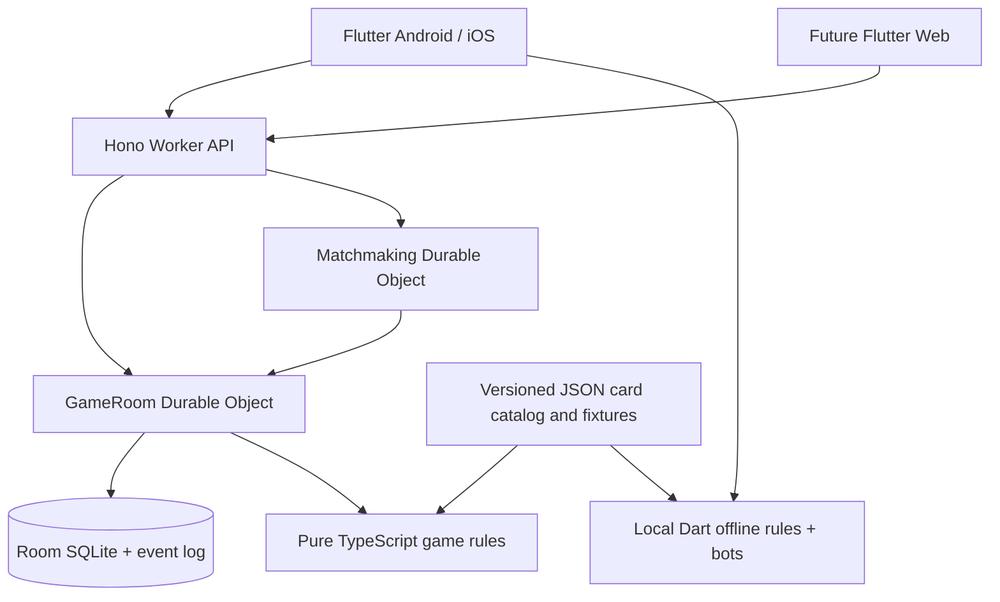

# FIBPOP Architecture — Baseline v1

## Locked stack

- **Client:** Flutter (Android/iOS) with Flutter UI for cards/lobby and Flame only when its animation/game-loop features add value; Riverpod or another consistent Flutter state manager (select and pin during M1).
- **Web later:** Flutter Web, hosted on Cloudflare Pages.
- **API:** TypeScript + Hono on Cloudflare Workers; Zod validation.
- **Multiplayer:** Cloudflare Durable Objects (one `GameRoom` per match; separate matchmaking coordinator) with native **WebSocket Hibernation API**.
- **Persistence:** SQLite-backed Durable Object storage for game room, event log and snapshots; avoid global relational DB in MVP. Add Neon only when cross-match user accounts/entitlements/reporting justify it.
- **Offline:** Pure Dart rules engine + basic bots; no network dependencies.
- **Tests / deploy:** Vitest/Workers integration tests, flutter_test, Wrangler, GitHub Actions.

## Logical diagram

## Data / trust boundaries

- Worker authenticates a signed, expiring guest session; client-supplied `playerId` is never trusted for ownership.
- Only one GameRoom instance owns and serializes moves for that match. Server shuffles cards/roles with secure RNG, not a client seed; game event log contains non-public payloads and is never returned wholesale.
- **Public projection:** player order, public hearts/suspicion, card counts, visible effects, current player, and generalized Cornered phase. Sensitive window deadlines and internal match versions are not public.
- **Private projection:** own hand, own role, own Evidence targets, private prompts.
- **Never sent:** opponents' hands/roles, deck order, hidden random state, unearned Evidence.
- All game actions: type validated, actor authorized, phase/turn validated, card ownership checked, state version checked, idempotency key checked, committed before client acknowledgement.
- Engine transition events contain private state, including sealed choices. Never send or log them in plaintext; the room must encrypt sensitive event persistence and restrict decryption before implementing durable replay.

## Offline consistency

Two runtimes are a deliberate trade-off: TypeScript authoritative online and Dart offline. Keep rules pure. Shared content is JSON with stable card IDs. Establish cross-engine fixtures describing initial state, command, expected result, and RNG seed for tests. Execute fixtures in both TypeScript and Dart CI. **Never treat the offline client's result as trusted in an online match.**

## Room lifecycle

`created → lobby → ready_check → dealing → active_turn → awaiting_reaction → awaiting_accusation → awaiting_secret_finish → awaiting_last_chance → active_turn/turn_start → finished → archived`.

Room storage persists event IDs, public/private state, deadlines, roles/deck order, reconnect credential hashes, and version. Use DO alarms/deadlines, not permanent timers, to support hibernation. On reconnect reauthenticate and send a per-player snapshot. Socket attachments should contain only minimal safe metadata to recover after hibernation.

## Matchmaking and invite links

- Private room: generated high-entropy nonsequential code; rate-limited join attempts; code is a room locator, not an auth token; lobby host may start when 4–8 players ready.
- Quick Start: public queue with ticket TTL, region/language preference as *soft* preferences, atomic room assignments, ready check, cancellation/queue rejoin.
- Never include role or hand data in URLs, logs, push notifications, or analytics.

## Deployment and cost controls

Cloudflare Workers Free and SQLite-backed DOs can be used for low-volume launch, but free limits are hard caps. Cloudflare Durable Objects Hibernation avoids duration billing when idle. Requests, messages, SQL reads/writes, alarms and persistent data remain metered. Separate staging and production environments; disable uncontrolled verbose logging; deploy with Wrangler; set budget/usage checks and plan an upgrade to Workers Paid before significant promotion.

DO NOT assume Node.js frameworks are fully compatible with Workers: Hono HTTP routing, native DO realtime handling, no mandatory Express/Socket.IO.

## Portable architecture

Keep interfaces such as `RoomRepository`, `Clock`, `RandomSource`, `GameEngine`, `PlayerViewProjector`, `EventPublisher` outside Hono and DO imports. DO adapters should own Cloudflare-specific code, with a possible future Node server adapter replacing only infrastructure layers.

## Official references (verified Nov 2026)

- https://developers.cloudflare.com/durable-objects/platform/pricing/
- https://developers.cloudflare.com/durable-objects/best-practices/websockets/
- https://hono.dev/docs/getting-started/cloudflare-workers
